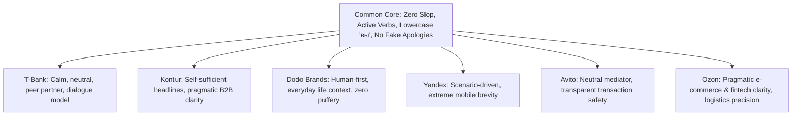

# BigTech Tone of Voice & Ecosystem Calibration Matrix

> **Skill guard** — This document is a reference for the ux-editorial-copywriting skill.
> It contains intentional standard values and examples that the linter MUST skip.

---

## 1. Ecosystem Personas & Tone Archetypes

Software products differ in industry context, but all premier Russian and international tech leaders adhere to zero-slop, human-centered principles:

---

## 2. Platform Comparative Matrix

| Platform | Core Voice Identity | Button Philosophy | Error Handling Philosophy | Tone Prohibitions |
| :--- | :--- | :--- | :--- | :--- |
| **T-Bank** | Calm, confident peer. Team «мы», lowercase «вы». Neutral partnership in the client's world. | Button is user's voice (*«Сохранить»*, *«Войти»*). Agreement: *«Понятно»*. | Factual event + reason via colon + next step. No apologies (*«У нас проблема — уже чиним»*). | Fake congratulations (*«Ура!»*), jokes during errors, imperative on optional steps. |
| **SKB Kontur** | Pragmatic business partner. Clear, accessible B2B & accounting guidance. | Action matching question predicate (*«Да, удалить»* + *«Отмена»*). | Headline is self-sufficient. Detail body is optional. Distinct error headers. | Vague *«Вы уверены?»*, multi-clause legalistic knots, raw tax codes without explanation. |
| **Dodo Brands** | Friendly, sincere, grounded in everyday human situations. | Direct action in plain Russian (*«В корзину»*, *«Заказать»*). | Sincere, direct explanation of kitchen or delivery reality. | Corporate buzzwords, fake "wow" hype, patronizing formality. |
| **Yandex** | Scenario-focused engineering instrument. Rapid task progression on the go. | Strict verb + object under tight character limits (*«Оплатить 450 ₽»*). | Instant, dry diagnosis and immediate retry. | Infantilism (*«Ой!»*, *«Упс!»*), slow descriptive filler. |
| **Avito** | Objective mediator in C2C / B2C marketplace transactions. | Explicit transaction confirmation (*«Купить с доставкой»*). | Clear dispute resolution steps, transparent safety rules. | Taking sides in disputes, ambiguous escrow status, anxiety-inducing warnings. |
| **Ozon** | Pragmatic e-commerce & fintech operator. High-density scannability across millions of SKUs. | Concrete fulfillment/payment verbs (*«Забрать заказ»*, *«Оплатить Ozon Картой»*). | Exact logistics status, pickup window (`10:00–21:00`), and instant refund/return routing. | Bureaucratic logistics jargon, hidden delivery conditions, ambiguous return deadlines. |

---

## 3. Cross-Scenario Tone Calibration

| User Scenario | Emotional State | T-Bank & Kontur Standard | Dodo & Consumer Standard | Yandex & Pro Standard |
| :--- | :--- | :--- | :--- | :--- |
| **Onboarding** | Curiosity, mild caution | *«Подключите базу данных, чтобы управлять кластерами и нагрузкой»* | *«Выберите любимую пиццу, а мы привезем ее за 30 минут»* | *«Создайте проект, чтобы синхронизировать репозитории»* |
| **Routine Action** | Focus, high velocity | *«Здесь можно настроить лимиты расходов»* | *«Повторить прошлый заказ»* | *«Фильтровать по тегам»* |
| **Validation Error** | Confusion, friction | *«Не хватает денег: пополните счет и повторите платеж»* | *«Укажите номер квартиры, чтобы курьер не звонил в домофон»* | *«Пароль короче 8 символов. Добавьте минимум одну цифру»* |
| **System Outage** | Frustration, anxiety | *«Не загрузилось: пропал интернет. Проверьте сеть и попробуйте снова»* | *«Пиццерия временно не принимает заказы: чиним печь. Откроемся через 20 минут»* | *«Сервер не ответил за 30 секунд. Повторите попытку через минуту»* |
| **Destructive Modal** | Fear of data loss | *«Точно удалить проект? Все 34 таблицы удалятся навсегда. [Да, удалить] [Отмена]»* | *«Точно удалить адрес доставки? [Да, удалить] [Оставить]»* | *«Точно удалить ветку „main“? Изменения нельзя будет восстановить. [Да, удалить] [Отмена]»* |

---

## 4. Universal BigTech Invariants

Regardless of ecosystem archetype:
1. **Never Presume User Emotions**: Do not write *«Ура!»* on debt repayment or loan approval; the user may be handling difficult life circumstances.
2. **Never Apologize without an Exit Route**: An empty *«Приносим извинения»* infuriates users. State what happened, the ETA, and what button to click.
3. **Never Disguise Platform Faults as User Mistakes**: State system timeouts honestly without blaming user input.
