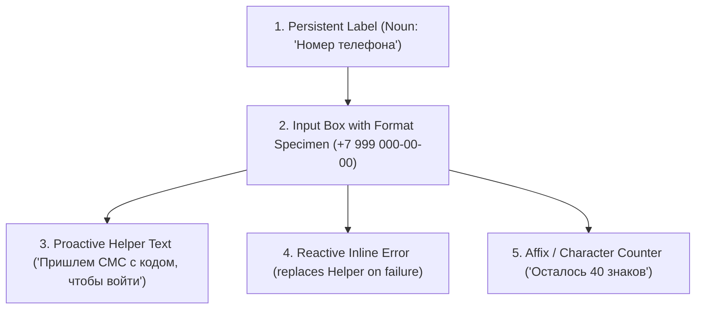

# Dynamic Counters, Form Fields & Platform Surface Constraints

> **Skill guard** — This document is a reference for the ux-editorial-copywriting skill.
> It contains intentional standard values and examples that the linter MUST skip.

---

## 1. Dynamic Counters & Russian Pluralization (Склонение числительных)

Interface counters require strict grammatical agreement across 3 plural categories (`one`, `few`, `many`) and predicate gender agreement:

### 1.1 The 3-Category Plural Matrix

| Category | Numerical Range Pattern | Noun Form (RU) | Production Example |
| :--- | :--- | :--- | :--- |
| **`one`** | Ends in 1, except 11 (`1, 21, 31, 101...`) | Именительный падеж, ед. число | *1 товар, 21 день, 101 бонус, 1 минута* |
| **`few`** | Ends in 2, 3, 4, except 12, 13, 14 (`2–4, 22–24...`) | Родительный падеж, ед. число | *2 товара, 23 дня, 4 бонуса, 2 минуты* |
| **`many`** | Ends in 5–9, 0, or 11–19 (`0, 5–20, 25–30...`) | Родительный падеж, мн. число | *0 товаров, 5 товаров, 14 дней, 20 бонусов* |

### 1.2 Predicate & Verb Agreement in UI Strings

In past tense and passive participles, verbs agree with the numerical phrase according to grammatical gender:

| Entity Gender | Form for `one` (1) | Form for `few` (2–4) | Form for `many` (5+ / 0) |
| :--- | :--- | :--- | :--- |
| **Мужской род** (*товар, заказ, день*) | *Выбран 1 товар* | *Выбрано 2 товара* | *Выбрано 5 товаров* |
| **Женский род** (*карта, позиция, минута*) | *Привязана 1 карта* | *Привязано 2 карты* | *Привязано 5 карт* |
| **Средний род** (*письмо, уведомление*) | *Удалено 1 письмо* | *Удалено 2 письма* | *Удалено 5 писем* |

> [!TIP]
> **Zero State Rule**: For dedicated empty states, prefer qualitative human phrases (*«Корзина пуста»*, *«Нет уведомлений»*) instead of sterile zero-counters (*«0 товаров в корзине»*). Preserve zero-counters only inside active search filters or balance badges (*«0 бонусов»*).

---

## 2. Form Microcopy & Validation Architecture (Анатомия поля ввода)

A production-grade input field consists of 5 coordinated microcopy layers. Never collapse labels into placeholders or shout errors without recovery paths:

### 2.1 Layer-by-Layer Authoring Standards

1. **Persistent Label**:
   - Formulation: Noun phrase in nominative case (*«Номер телефона»*, *«Адрес доставки»*, *«Рабочая почта»*).
   - Placement: Always above the input field. Never rely on floating placeholders that vanish upon typing.
   - Punctuation: No trailing colons (*«Адрес доставки:»* is banned).
2. **Format Placeholder**:
   - Formulation: Realistic format specimen (`+7 999 000-00-00`, `admin@company.ru`).
   - Anti-Pattern: Never write instructional commands inside placeholders (*«Введите номер телефона»* is banned).
3. **Helper Text (Proactive)**:
   - Formulation: Reassuring explanation of what happens next or formatting bounds (*«Пришлем код подтверждения»*, *«От 8 символов, минимум одна цифра»*).
4. **Inline Error (Reactive)**:
   - Formulation: Self-sufficient diagnostic with immediate fix (*«В номере не хватает 2 цифр. Проверьте номер»*, *«Такой email уже занят. [Войти в аккаунт]»*).
   - Anti-Pattern: Never use sterile developer phrases (*«Неверный формат»*, *«Ошибка валидации»*).
5. **Required vs Optional Marking**:
   - **BigTech Standard**: If 80%+ of form fields are mandatory, do NOT pollute the screen with red asterisks (`*`) on every line. Asterisks cause visual clutter and anxiety.
   - **Rule**: Mark only the rare optional fields with a neutral badge or label suffix: *«(необязательно)»*.

---

## 3. Platform & Surface Constraints (Платформы и каналы доставки)

### 3.1 Mobile Native UI (iOS HIG vs Android Material 3)

| Surface | iOS Human Interface Guidelines | Android Material 3 Standard |
| :--- | :--- | :--- |
| **Top Navigation Bar** | Strictly 1-word actions (*«Готово»*, *«Отмена»*, *«Закрыть»*, *«Править»*). Never wrap text. | Concise actions or standard icons. Sentence case. |
| **Back Button** | *«Назад»* or previous view title ($\le 12$ characters). | Standard chevron arrow; no text label. |
| **System Dialogs / Alerts** | Title is bold, short (1–3 words). Body is standard. Destructive action is highlighted in red. | Title is headline-small. Action buttons at bottom right. |
| **Action Sheet / Bottom Sheet** | Destructive action separated or top; *«Отмена»* in independent bottom container. | List items with left icons; neutral dismissal on backdrop tap or drag handle. |
| **Toasts / Snackbars** | Native iOS avoids toasts; use modal sheets or Undo banners. | Max 1 line of copy + 1 action button ($\le 8$ words total). Auto-dismiss in 4–7 seconds. |

### 3.2 External Notification Channels (Push & SMS)

1. **Push Notifications**:
   - **Title**: $\le 30\text{--}40$ characters. Bold, no trailing period. Must state the event directly (*«Заказ уже в пути»*).
   - **Body**: $\le 100\text{--}120$ characters. Front-load value in the first 5 words so it survives notification lock-screen truncation.
   - **Action Buttons**: $\le 15\text{--}20$ characters (*«Отследить заказ»*, *«Ответить»*).
2. **SMS & OTP Messages**:
   - **Segment Limit**: Russian Cyrillic SMS messages are strictly limited to **70 characters per segment** (subsequent segments drop to 67 characters). Exceeding 70 characters doubles messaging costs for the business.
   - **OTP Code Front-Loading**: Put the security code in the first 30 characters so the user sees it in the lock-screen banner without opening the SMS app:
     - [GOOD]: *«Код 4920. Никому его не сообщайте»* (34 characters $\to$ 1 segment).
     - [BAD]: *«Уважаемый клиент нашего банка! Для подтверждения операции входа введите проверочный код 4920»* (92 characters $\to$ 2 segments, bloated, delayed code).

---

## 4. Chesterton's Fence in UI Copy (Редизайн текстов)

When auditing or rewriting existing interface copy (Before vs After):

1. **Investigate What Was Removed**:
   Before deleting an "ugly" or long paragraph, identify why it was placed there historically:
   - Is it a regulatory or legal requirement (license number, terms of escrow)?
   - Is it a critical logistical boundary (weight recalculation in grocery carts, delivery window limitations)?
   - Is it an anti-support cushion (explaining why funds take 3 days to unlock)?
2. **Condense Without Dropping Context**:
   Transform bureaucratic legal text into ergonomic plain Russian rather than deleting the condition entirely:
   - *[Before]: «Обращаем ваше внимание, что окончательная стоимость заказа может быть изменена в связи с возможной корректировкой веса весовых позиций при сборке.»*
   - *[After]: «Итоговая сумма может измениться: точный вес продуктов определим при сборке»*
3. **Comparative Copy Matrix**:
   When presenting copy redesigns, use the clean comparative layout:
   `Компонент | До (Old Copy) | Дефект | После (3 яруса) | Что сохранили`
