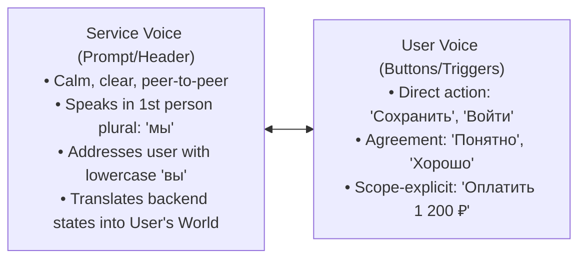

# Editorial Infostyle, Voice & Screen Typography Code

> **Skill guard** — This document is a reference for the ux-editorial-copywriting skill.
> It contains intentional standard values and examples that the linter MUST skip.

---

## 1. The Dialogic Interface Model & The User's World (BigTech Standard)

An interface is an ergonomic dialogue between a user and a respectful software service:
- **Buttons, tabs, and interactive triggers are the user's voice**: They express the user's immediate intent (*«Сохранить»*, *«Войти»*, *«Оплатить 4 990 ₽»*).
- **Headings, prompts, and status messages are the service's voice**: They describe state, outline options, and guide resolution (*«Не хватает денег: пополните счет и повторите платеж»*).

### 1.1 Мир пользователя vs Мир системы (Translating Backend States into Human Reality)

Users do not interact with databases, JSON payloads, HTTP codes, or validation pipelines — they transfer money, book tickets, order food, and submit reports. Never leak internal architecture (*Мир системы*) into customer-facing screens; always translate state into the *Мир пользователя* (T-Bank, SKB Kontur, Yandex, Ozon, Avito standard):

| Мир системы (Banned Backend Leak) | Мир пользователя (2026 BigTech Standard) |
| :--- | :--- |
| *«Ошибка валидации токена авторизации (401)»* | **«Сессия закончилась. Войдите снова, чтобы продолжить»** |
| *«Запись в БД не найдена / Объект не существует»* | **«Страница удалена или переехала»** / **«Такого заказа нет»** |
| *«Превышен лимит запросов к API (Rate limit exceeded)»* | **«Слишком много попыток подряд. Подождите минуту и попробуйте снова»** |
| *«Некорректное значение параметра `inn_length`»* | **«В ИНН компании должно быть 10 цифр, а сейчас — 9»** |
| *«Синхронизация ассетов завершена с кодом 0»* | **«Файлы обновились на всех устройствах»** |
| *«Транзакция отклонена шлюзом эквайринга»* | **«Банк отклонил платеж. Попробуйте другую карту или СБП»** |

---

## 2. Birman's 3 Levels of Verb Aggression

Do not boss the user around. The imperative mood creates psychological friction when applied indiscriminately:

| Level | User Scenario | Permitted Verb Structure | BigTech Production Example | Forbidden Anti-Pattern |
| :--- | :--- | :--- | :--- | :--- |
| **Level 1: Mandatory Step** | User cannot complete flow without this action. | Direct imperative or infinitive verb. | *«Введите 4 цифры из СМС»*, *«Укажите рабочий email»* | Timid passive: *«Код должен быть введен пользователем»* |
| **Level 2: Optional Feature** | User is exploring dashboard or optional setting. | Possibility framing; neutral description. | *«Здесь можно изучить траты»*, *«За это можно получить бонусы»* | Aggressive orders: *«Изучайте траты!»*, *«Получайте бонусы!»* |
| **Level 3: Critical Alert** | Destructive risk or system failure. | Calm, grave, consequence-first statement. | *«Точно удалить проект? Все 45 таблиц удалятся навсегда»* | Flashing hysteria: *«Внимание! Опасность! Срочно подтвердите!»* |

---

## 3. Peer Persona: Lowercase 'вы', Team 'мы' & Gender Neutrality

1. **Lowercase 'вы'**:
   - Always address users with lowercase **«вы»**, **«вам»**, **«вас»**.
   - Capitalized *«Вы»* is an archaic bureaucratic affectation that creates distance and visual noise. At the beginning of a sentence, start directly with the verb or noun (*«Можете отключить подписку в любой момент»*, *«Одобрили вам кредит»*) so *«Вы/Вам»* never appears capitalized.
2. **Team 'мы'**:
   - Speak as an accountable team in the first person plural: *«Мы поможем настроить профиль»*, *«Пришлем уведомление, когда отчет будет готов»*.
   - Never refer to the platform in the third person (*«Сотрудники сервиса свяжутся»* or *«Система произведет обработку»*).
3. **Gender Neutrality**:
   - Never use slashes or parentheses for gender (*«подал/подала»*, *«согласен(на)»*).
   - Use gender-free grammatical structures:
     - Past event: *«Карта потерялась»* (instead of *«Я потерял карту»*).
     - Future action: *«Подам уведомление самостоятельно»* (1st person future tense has no gender in Russian).
     - Legal consent: *«Нажимая «Оплатить», вы соглашаетесь...»* (participial clause instead of gendered *«согласен»*).

---

## 4. The Complete Screen Typography Code

### 4.1 Points & Trailing Full Stops
- **Never put a trailing period** in:
  - Headings and subheadings (`h1`–`h6`).
  - Button and tab labels (*«Сохранить»*, *«Далее»*).
  - Field labels, placeholders, and tooltips/hints.
  - Table cell values and status badges.
  - Links that terminate a sentence or standalone bullet.
- **Period between sentences**: If a helper text or modal description contains two sentences, put a period between them, but omit the trailing period at the end of the last sentence.

### 4.2 Dashes, Minuses & Hyphens
- **Em-dash (`—`)**: Used between words in running copy and verbal ranges (`понедельник — пятница`, `Москва — Казань`). MUST be space-padded with a non-breaking space on the left (`&nbsp;— `). Do not use in headings (causes excessive visual clutter).
- **En-dash (`–` / `\u2013`)**: Used in numerical, temporal, and price ranges **WITHOUT spaces** (Milchin, Lebedev § 97, Kontur Guides, T-Bank, Gramota.ru): `25–27 сентября`, `19:00–20:00`, `10–15 мин`, `1 000–10 000 ₽`, `5–7%`.
  - **Ban on Hybrid Preposition-Dash**: Never combine the preposition `с` or `от` with a dash (`с 10:00–19:00` or `от 5–10 дней` is ungrammatical). Write either `10:00–19:00` or `с 10:00 до 19:00`.
- **Hyphen (`-`) & Non-Breaking Hyphen (`‑` / `\u2011`)**: Used inside compound words (`2-НДФЛ`, `онлайн-касса`, `3-комнатная`). In short acronyms (`QR‑код`, `ПИН‑код`, `СМС‑код`, `SMS‑код`, `CVV‑код`, `пуш‑уведомление`), ALWAYS use non-breaking hyphen `‑` (`\u2011`) to prevent splitting across lines on mobile screens.
- **Minus (`−` / `\u2212`)**: Used exclusively for mathematical subtraction, negative values, temperatures, and discounts (`−37,11 ₽`, `−15%`, `−10 °C`). Never substitute standard ASCII hyphen `-` for minus.
- **Percent (`%`)**: Attached directly to the number without space (`15%`, `50%`). Never write `15 %`.

### 4.3 Non-Breaking Spaces (`&nbsp;` / `\u00A0`)
- **Mandatory bindings**:
  - Before long dash (`&nbsp;— `).
  - After short prepositions and conjunctions (`в`, `на`, `с`, `и`, `к`, `у`, `о`, `а`, `но`, `от`, `до`, `по`, `из`, `не`, `ни`).
  - Before particles (`бы`, `ли`, `же`).
  - Inside numbers of 4+ digits (`10 000 ₽`, `1 000 000 ₽`) and between numbers and currency/units (`1 000&nbsp;₽`, `8&nbsp;ч 35&nbsp;мин`, `1,5&nbsp;МБ`).
- **Surface Encoding Rule**: Use literal `&nbsp;` in Markdown UX specifications and raw HTML templates; use Unicode `\u00A0` (or clean strings without raw HTML entities) when writing into Figma text nodes, JSON i18n dictionaries, and TSX/JSX string literals.

### 4.4 Abbreviations & Units (Zero Trailing Periods)
- **Do NOT put dots after UI abbreviations and units**:
  - Units: `тыс`, `млн`, `млрд`, `ч`, `мин`, `сек`, `шт`, `кг`, `г`, `л`, `кв. м`, `ГБ`, `МБ`, `КБ`, `ТБ`, `руб` (all without trailing dots).
  - Months: `янв`, `февр`, `март`, `апр`, `май`, `июнь`, `июль`, `авг`, `сент`, `окт`, `нояб`, `дек`.
  - Days of week: `пн`, `вт`, `ср`, `чт`, `пт`, `сб`, `вс`.

### 4.5 Currency, Numbers, Dates & Ordinal Suffixes (Грамота.ру / Контур 2026)
- **Ruble Symbol (`₽`)**: Always placed AFTER the number, separated by a non-breaking space: `1 000 ₽`.
- **No Kopecks in Round Figures**: Write `10 ₽`, never `10,00 ₽`. If fractional kopecks exist, write exactly 2 decimal places: `10,25 ₽`.
- **Zero Number Suffixes in Cardinal Counts**: Write `2 рабочих дня`, `5 сотрудников`, `10 минут` — never `2-х рабочих дней`, `5-ти сотрудников`, `10-ти минут`.
- **Ordinal Number Suffixes (Наращения порядковых числительных)**:
  - **1-letter suffix** if the final letter of the numeral word is preceded by a vowel: `1-й шаг`, `2-я линия`, `3-е место`, `5-й день`, `в 3-м квартале`.
  - **2-letter suffix** if the final letter is preceded by a consonant: `2-го уровня`, `3-му клиенту`, `из 7-ми`.
  - **Banned Illiterate Suffixes**: Never write 2- or 3-letter vowel suffixes (`1-ый`, `2-ой`, `3-ий`, `5-ого`, `3-его`, `2-ому`, `3-им`, `1-ая`, `2-ое`).
  - **Banned Suffixes on Dates & Years**: Never attach suffixes to calendar dates or years (`25 сентября 2026 года`, `в 2026 году` — never `25-го сентября`, never `2026-го года`, never `в 2026-м году`).
- **Date & Time Formats**:
  - In running copy, cards, and notifications: write the month in words (`5 мая`, `12 ноября 2026`). Omit the current year unless disambiguating past/future years.
  - In dense tables and inputs: use `ДД.ММ.ГГГГ` (`05.05.2026`). Time uses 24-hour `ЧЧ:ММ` (`14:30`).
- **Decimal Separator**: Use a comma in Russian UI strings (`1,5 МБ`, `0,5%`).
- **Quotes**: External French guillemets (*«...»*), internal German quotes (*„...“*). Straight quotes (`"..."`) are prohibited in Russian prose.

---

## 5. UI Link Standards

- **Semantic anchor**: Links must state the destination entity (*«Условия подписки»*, *«Тарифы на эквайринг»*). Never use isolated generic words (*«тут»*, *«здесь»*, *«подробнее»*).
- **Length**: Maximum 5 words.
- **Punctuation**: Never place a period after a standalone link. Prepositions and quotation marks are included inside the link anchor text (Birman rule).
