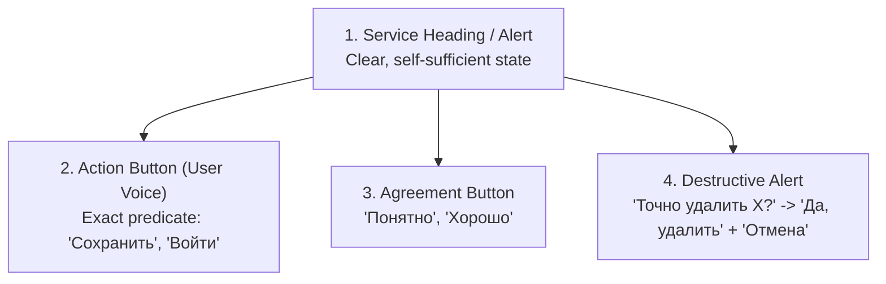

# Component Microcopy & Interaction Semantics Specification

> **Skill guard** — This document is a reference for the ux-editorial-copywriting skill.
> It contains intentional standard values and examples that the linter MUST skip.

---

## 1. Operational Interface Semantics (BigTech Component Model)

Interface microcopy is not decorative prose; it is an **operational control mechanism**. Every component string answers the user's implicit question: *"What will happen immediately when I interact with this?"*

---

## 2. Buttons & Calls-to-Action (The User's Voice)

### 2.1 Primary & Secondary Actions
- **User Intent**: The button label is a first-person utterance answering the question *"What do I want to do?"*.
- **Standard Verbs**: Use direct action infinitives or strong imperatives (*«Сохранить»*, *«Войти»*, *«Удалить»*, *«Перевести»*).
- **Scope Specification**: When multiple entities exist on the screen, append the direct object (*«Оплатить 4 990 ₽»*, *«Экспортировать CSV (1,4 МБ)»*, *«Отправить приглашение»*).
- **Agreement Buttons**: When confirming that informational copy has been read, use natural human acknowledgment: **«Понятно»** or **«Хорошо»** (never cold *«ОК»* or bureaucratic *«Подтвердить»*).
- **Prohibited Button Prefixes**: Never formulate button labels as child desires (*«Хочу удалить»*, *«Хочу оформить»*), present continuous from system's perspective (*«Сохраняю»*), or verbose first-person confirmations (*«Я понял»*, *«Я согласен»*). Use direct infinitives/imperatives (*«Удалить»*, *«Оформить»*, *«Сохранить»*) or natural acknowledgment (*«Понятно»*).
- **Transition Buttons**: When starting a multi-step or intimidating process, use *«К + [процесс]»*: **«К получению денег»**, **«К настройке кластера»**.

| Action Category | Banned Vague CTA | Compliant Standard (RU) | Compliant Standard (EN) |
| :--- | :--- | :--- | :--- |
| **Financial / Checkout** | «Далее», «Купить», «Ок» | **«Оплатить 4 990 ₽»** | **"Pay $49.00"** |
| **Destructive Deletion** | «Да», «Подтвердить» | **«Да, удалить»** | **"Yes, delete"** |
| **Data Export** | «Скачать всё», «Кликните сюда» | **«Экспортировать CSV (1,4 МБ)»** | **"Export CSV (1.4 MB)"** |
| **Team Invite** | «Submit», «Нажмите здесь» | **«Отправить приглашение»** | **"Send invitation"** |
| **Informational Acknowledgment** | «ОК», «Подтверждаю» | **«Понятно»** / **«Хорошо»** | **"Got it"** / **"Understood"** |
| **Settings Save** | «Применить параметры» | **«Сохранить»** / **«Сохранить изменения»** | **"Save"** / **"Save changes"** |

---

## 3. Alerts & Destructive Confirmation (T-Bank & Kontur Standard)

### 3.1 Confirmation Pairing Rule
To prevent accidental data loss and cognitive strain:
1. **Header Question**: Formulate as *«Точно сделать [действие]?»* (*«Точно удалить проект „Billing v2“?»*).
2. **Primary Button**: State the exact affirmative action: **«Да, удалить»**.
3. **Secondary Button**: Use the non-action noun: **«Отмена»** (or **«Оставить»**, **«Не сейчас»**).
   *Rationale*: If the secondary button said *«Отменить»*, users would confuse *«Удалить»* and *«Отменить»*. Using a noun without an action verb makes the buttons visually and semantically distinct.
4. **Description in the User's World**: State the concrete consequences (*«Все 34 задачи, 12 документов и история версий удалятся навсегда»*). Never use vague questions (*«Вы уверены?»*).

### 3.2 Frequent Actions: The Undo Toast
For low-blast-radius or high-frequency actions (archiving a task, moving an email), **do not interrupt with a modal**. Use an auto-dismissing toast with an immediate Undo button: *«Задача перемещена в архив. [Отменить]»*.

---

## 4. Error Messages: Flexible & Human Routing

An error message without an exit path is a UX failure. Modern BigTech error copy connects event and reason naturally via a **colon** or **dash**:

$$\mathbf{\text{Error Copy}} = [\text{Factual Headline (Self-Sufficient)}] + [\text{Reason via Colon / Dash}] + [\text{Immediate Next Step}]$$

### 4.1 Production Error Transformations

| Scenario | Banned AI-Slop Error | Production BigTech Standard (RU) | Production BigTech Standard (EN) |
| :--- | :--- | :--- | :--- |
| **Network Timeout** | *"Oops! An unexpected error occurred. Please try again later."* | **«Схема не сохранилась: пропал интернет. Проверьте сеть и попробуйте снова»** | **"Schema not saved: connection dropped. Check your network and retry"** |
| **Insufficient Funds** | *"Недостаточно средств. Операция не может быть выполнена. Требуется пополнить счет"* | **«Не хватает денег: пополните счет и повторите платеж»** | **"Not enough funds: top up your account and retry payment"** |
| **Quota Limit** | *"File size error! The file is too big to upload into the database."* | **«Файл больше 10 МБ. Сожмите картинку или загрузите файл до 10 МБ»** | **"File exceeds 10 MB limit. Compress image or upload file under 10 MB"** |
| **Duplicate Identifier** | *"Invalid name. Name already exists in system records."* | **«Имя „acme-prod“ уже занято. Придумайте другое название»** | **"Workspace URL 'acme-prod' is taken. Choose another identifier"** |

---

## 5. Empty States: The 3-Archetype Matrix (T-Bank, Kontur, Avito, Ozon Standard)

Never treat all empty screens identically. Distinguish between **Initial Onboarding**, **Search/Filter Zero-Results**, and **Cleared/Inbox-Zero** states:

| Empty State Archetype | User Scenario | Mandatory Formula | Production BigTech Specimen |
| :--- | :--- | :--- | :--- |
| **1. Initial Empty State (Onboarding)** | User opens a section for the first time; zero entities exist yet. | `[Factual State Header]` + `[Value via «чтобы»]` + `[User-Voice Create CTA]` | **Автобэкапы не настроены** Включите регулярные снимки, чтобы не потерять данные при сбое. `[Включить бэкапы]` |
| **2. Search / Filter Zero-Results** | Data exists in the account, but the current query or filter matched nothing. | `[По запросу «X» ничего не нашлось]` + `[Typo/Filter Hint]` + `[Reset CTA]` | **По запросу «инвойс» ничего не нашлось** Проверьте, нет ли опечаток, или сбросьте фильтры. `[Сбросить фильтры]` |
| **3. Cleared / Inbox-Zero State** | User completed all items (paid all bills, resolved all tickets). | `[Calm Completion Fact]` + `[When New Items Appear]` (No forced CTA) | **Все счета оплачены** Новые квитанции появятся здесь в начале следующего месяца |

---

## 6. Input Fields, Placeholders & Helper Text

1. **Persistent Field Label**: Placed above the field (*«Адрес корпоративной почты»*). Never hide inside placeholder. The label names the data, never an instructional command (*«Номер телефона»*, not *«Введите номер телефона»*).
2. **Format Placeholder**: Realistic syntax demonstration (`admin@company.com`, `+7 999 000-00-00`). Never give instructional commands (*«Введите ваш email»*, *«Начните писать...»*).
3. **Helper Text**: Concrete bounds (*«От 8 до 32 символов, минимум 1 цифра»*). Never state vague platitudes (*«Придумайте надежный пароль»*).
4. **Prohibited Label Commands**: Never start field labels with *«Введите...»*, *«Напишите...»*, or *«Укажите...»*. If a field is optional, append *«если есть»* (*«Отчество, если есть»*) or *«(необязательно)»*.

---

## 7. Toggles (Switches), Checkboxes & Tooltips

1. **Affirmative Toggle Law**:
   - Formulate switch and checkbox labels strictly in the **affirmative active voice** describing what happens when the toggle is **ON** (*«Показывать баланс на главном экране»*, *«Автоплатеж по счету»*, *«Присылать пуш‑уведомления»*).
   - **Ban on Negative Toggles**: Never use negative particles or disabling verbs in toggle labels (*«Не показывать баланс»*, *«Отключить звук»*, *«Скрыть уведомления»*). An `OFF` state combined with a negative label creates a cognitive double-negative trap.
2. **Tooltip Ergonomics**:
   - Never repeat the button or column title verbatim inside a tooltip.
   - Use tooltips strictly to explain hidden constraints, calculation formulas, or keyboard shortcuts (*«Недоступно на базовом тарифе»*, *«Сохранить черновик (Ctrl + S)»*). No trailing period on single-sentence tooltips.

---

## 8. Async Loading States & OS Permission Priming

1. **Meaningful Loading States (Labor Illusion)**:
   - For operations exceeding 2 seconds, eliminate sterile placeholders (*«Загрузка...»*, *«Пожалуйста, подождите»*).
   - State the concrete background process and expected duration: *«Проверяем реквизиты — это займет до 30 секунд»*, *«Собираем архив выписок за год»*.
2. **Pre-Permission Priming (Camera, Geo, Push, Contacts)**:
   - Before invoking a native OS permission dialog, explain the user value using *«чтобы [глагол]»*: *«Разрешите доступ к камере, чтобы сканировать QR‑коды и не вводить реквизиты вручную»*.

---

## 9. Tables & Data Grids (Контур.Гайды & B2B SaaS Standard)

1. **Column Headers**:
   - Write 1–2 words in nominative case (*«Статус»*, *«Дата создания»*, *«Ответственный»*), without trailing periods.
   - **Move Units to the Header**: Write `Сумма, ₽`, `Вес, кг`, `Объем, ГБ` in the column header so table cells contain clean, scannable numbers (`12 400`, not `12 400 ₽` repeated on every row).
2. **Empty Cells**:
   - Use an **em-dash (`—`)** when an optional or numeric value is absent.
   - Use a concise semantic label (*«Не назначен»*, *«Бессрочно»*) only when absence carries domain meaning. Never output developer literals (`null`, `undefined`, `N/A`, `Нет данных`).
3. **Status Badges inside Rows**:
   - Use short participles, adjectives, or nouns (*«Оплачен»*, *«Черновик»*, *«В работе»*, *«Отклонен»*) without trailing periods or verbs.

---

## 10. Paywalls, Subscriptions & FinTech Checkouts (Zero Dark Patterns)

1. **Honest Trial & Renewal Timeline**:
   - Explicitly state the free trial duration, exact date of the first charge, recurring price, and cancellation path before payment:
   - *Specimen:* «7 дней бесплатно, затем — 399 ₽ в месяц. Первое списание — 15 ноября. Отключить подписку можно в любой момент в профиле»
2. **Specific Checkout CTA**:
   - Paid immediately: **«Оплатить 399 ₽»**
   - Free trial activation: **«Попробовать 7 дней бесплатно»** or **«Подключить на 7 дней за 0 ₽»**
3. **Neutral Opt-Out (Zero Confirmshaming)**:
   - Never guilt-trip the user (*«Нет, я хочу переплачивать»*). Use calm, neutral dismissal labels: **«Пока пропустить»**, **«Оставить базовый тариф»**, **«Не сейчас»**.

---

## 11. The 3-Tier Delivery Spectrum (Dual-Mode Calibration)

- **Mode A — Direct Production Copy**: When editing source code (`.tsx`, `.json`, `.html`), mutating live Figma frames, or answering isolated button/label queries, deliver the **single optimal phrasing** that fits the component container.
- **Mode B — 3-Tier Editorial Matrix**: When authoring UX copy specifications, empty states, modals, or Before/After flow redesigns, provide 3 options per component:
  - **Tier 1 (Terse / 1–3 words)**: Maximum glanceability for mobile buttons, tight tables, toolbars.
  - **Tier 2 (Conversational / Human)**: Calm peer-to-peer phrasing for modals, onboarding, everyday UI.
  - **Tier 3 (Instructive / Reassuring)**: Explicit, step-by-step guidance for high-friction or error recovery states.
